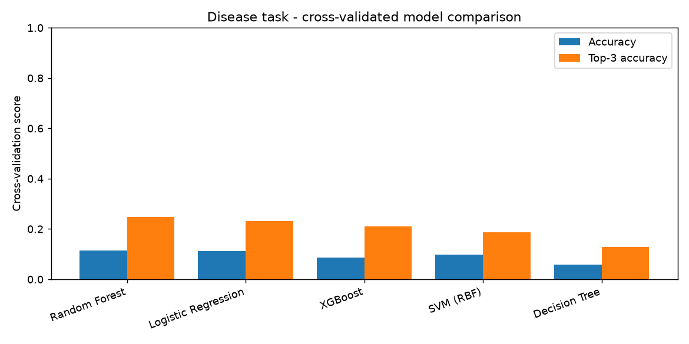
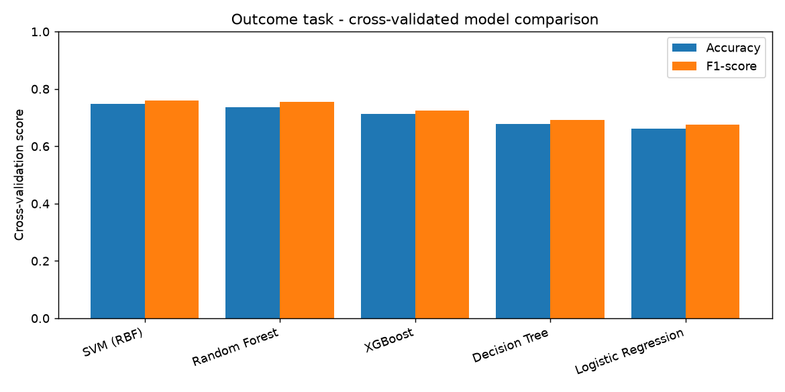
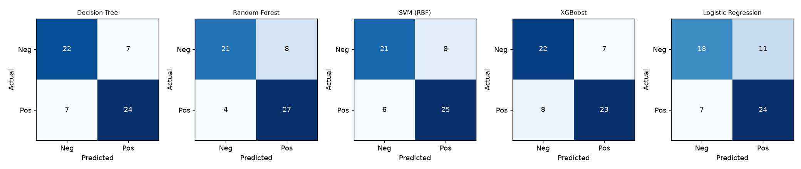
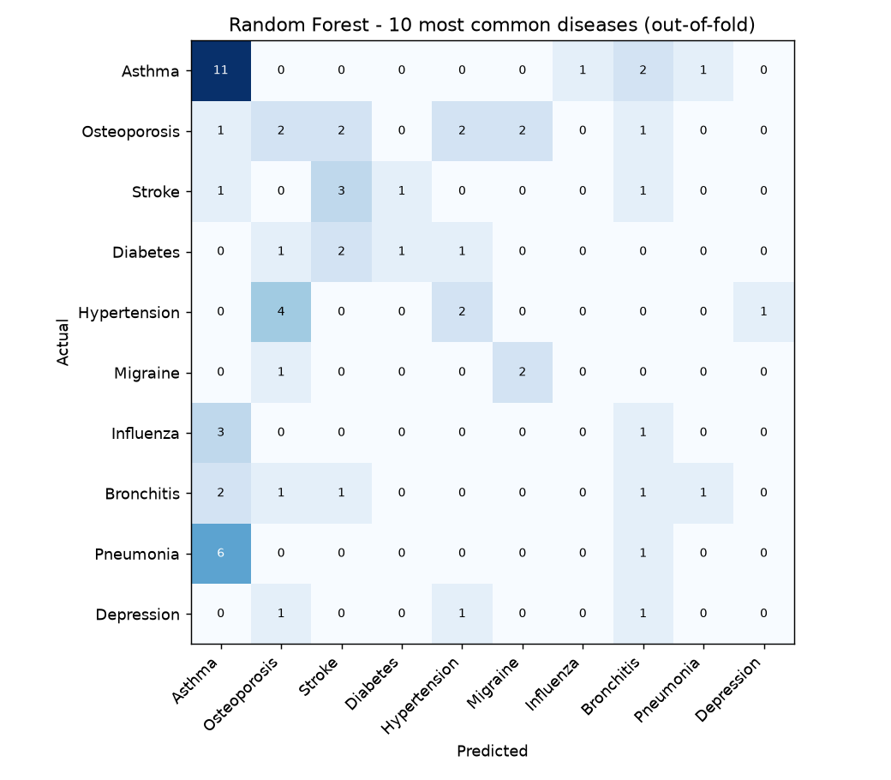

# Model Evaluation & Selection Report
## MedAssist AI - Module 3 (Member 3: Model Evaluation & Selection)

Generated by `ml_models/evaluation/evaluate_models.py` from the models
trained by `ml_models/training/train_models.py`.

> MedAssist AI is a preliminary decision-support tool. Scores below
> describe model behaviour on a small dataset; they are not medical
> certainty and the predictions are not diagnoses.

## 1. How the models were evaluated

- **Hold-out test set** (20% of the data, `random_state=42`): used for
  accuracy, precision, recall, F1-score and the confusion matrix.
  Only 45 rows (disease) and 60 rows (outcome), so one wrong prediction
  moves accuracy by 1.7-2.2 points. It is a sanity check, not a verdict.
- **Repeated stratified cross-validation** (5 folds x 3 repeats):
  each model is retrained 15 times on different splits and scores are
  averaged (mean ± standard deviation). **Model selection uses this.**
- **Baseline**: a dummy model that always predicts the most common class.
  A real model must clearly beat it to be worth using.
- Disease cross-validation uses only the 28 diseases that have at least
  5 records (195 rows). Diseases with 1-4 records cannot be split across
  five folds. The hold-out test still uses all 116 disease labels.
- For diseases, precision/recall/F1 are **weighted** averages (weighted by
  how many records each disease has); macro F1 is also shown.

## 2. Disease classification

### Cross-validation results (used for selection)

| Rank | Model | Accuracy | Top-3 accuracy | Precision (w) | Recall (w) | F1 (w) | Macro F1 |
| ---: | :--- | ---: | ---: | ---: | ---: | ---: | ---: |
| 1 | Random Forest | 0.115 ± 0.031 | 0.248 ± 0.057 | 0.083 ± 0.033 | 0.115 ± 0.031 | 0.089 ± 0.028 | 0.053 ± 0.021 |
| 2 | Logistic Regression | 0.113 ± 0.036 | 0.231 ± 0.069 | 0.053 ± 0.024 | 0.113 ± 0.036 | 0.070 ± 0.027 | 0.042 ± 0.019 |
| 3 | XGBoost | 0.087 ± 0.024 | 0.210 ± 0.039 | 0.075 ± 0.032 | 0.087 ± 0.024 | 0.074 ± 0.022 | 0.041 ± 0.011 |
| 4 | SVM (RBF) | 0.097 ± 0.023 | 0.188 ± 0.033 | 0.027 ± 0.012 | 0.097 ± 0.023 | 0.038 ± 0.014 | 0.020 ± 0.009 |
| 5 | Decision Tree | 0.058 ± 0.017 | 0.128 ± 0.025 | 0.056 ± 0.032 | 0.058 ± 0.017 | 0.052 ± 0.019 | 0.033 ± 0.009 |
| - | Baseline (most common) | 0.082 ± 0.010 | 0.195 ± 0.013 | 0.007 ± 0.002 | 0.082 ± 0.010 | 0.013 ± 0.003 | 0.005 ± 0.001 |



### Hold-out test results

| Model | Train acc. | Test acc. | Test top-3 | Precision (w) | Recall (w) | F1 (w) | Macro F1 |
| :--- | ---: | ---: | ---: | ---: | ---: | ---: | ---: |
| Decision Tree | 0.820 | 0.067 | 0.089 | 0.067 | 0.067 | 0.067 | 0.048 |
| Random Forest | 0.741 | 0.044 | 0.133 | 0.054 | 0.044 | 0.043 | 0.021 |
| SVM (RBF) | 0.051 | 0.133 | 0.200 | 0.072 | 0.133 | 0.073 | 0.044 |
| XGBoost | 0.494 | 0.044 | 0.133 | 0.044 | 0.044 | 0.044 | 0.029 |
| Logistic Regression | 0.173 | 0.067 | 0.200 | 0.031 | 0.067 | 0.042 | 0.022 |

### Selected model

**Random Forest**

Selection rule: highest cross-validated **top-3 accuracy** (the app
shows the three most likely diseases), then weighted F1.

- CV top-3 accuracy: 0.248 for Random Forest vs 0.231 for the runner-up (Logistic Regression) and 0.195 for the baseline.
- CV accuracy: 0.115 (baseline 0.082).
- Train accuracy minus hold-out accuracy: +0.697 (noticeable overfitting).
- The difference to the runner-up is smaller than the fold-to-fold spread, so the top models are statistically close; Random Forest is chosen because it ranks first by the rule above.

## 3. Outcome classification (Positive / Negative)

### Cross-validation results (used for selection)

| Rank | Model | Accuracy | Precision | Recall | F1-score | ROC-AUC |
| ---: | :--- | ---: | ---: | ---: | ---: | ---: |
| 1 | SVM (RBF) | 0.749 ± 0.046 | 0.765 ± 0.058 | 0.763 ± 0.095 | 0.759 ± 0.050 | 0.811 ± 0.058 |
| 2 | Random Forest | 0.737 ± 0.052 | 0.742 ± 0.063 | 0.776 ± 0.080 | 0.755 ± 0.046 | 0.835 ± 0.041 |
| 3 | XGBoost | 0.712 ± 0.037 | 0.726 ± 0.047 | 0.733 ± 0.081 | 0.726 ± 0.042 | 0.803 ± 0.042 |
| 4 | Decision Tree | 0.678 ± 0.042 | 0.696 ± 0.061 | 0.699 ± 0.081 | 0.693 ± 0.044 | 0.764 ± 0.052 |
| 5 | Logistic Regression | 0.662 ± 0.048 | 0.681 ± 0.054 | 0.680 ± 0.096 | 0.676 ± 0.054 | 0.761 ± 0.050 |
| - | Baseline (most common) | 0.523 ± 0.008 | 0.523 ± 0.008 | 1.000 ± 0.000 | 0.687 ± 0.007 | 0.500 ± 0.000 |



### Hold-out test results

| Model | Train acc. | Test acc. | Precision | Recall | F1-score | ROC-AUC |
| :--- | ---: | ---: | ---: | ---: | ---: | ---: |
| Decision Tree | 0.838 | 0.767 | 0.774 | 0.774 | 0.774 | 0.813 |
| Random Forest | 0.912 | 0.800 | 0.771 | 0.871 | 0.818 | 0.893 |
| SVM (RBF) | 0.796 | 0.767 | 0.758 | 0.806 | 0.781 | 0.887 |
| XGBoost | 0.863 | 0.750 | 0.767 | 0.742 | 0.754 | 0.860 |
| Logistic Regression | 0.700 | 0.700 | 0.686 | 0.774 | 0.727 | 0.796 |

### Confusion matrices (hold-out, 60 rows)

Rows = actual, columns = predicted (0 = Negative, 1 = Positive).

| Model | True Neg | False Pos | False Neg | True Pos |
| :--- | ---: | ---: | ---: | ---: |
| Decision Tree | 22 | 7 | 7 | 24 |
| Random Forest | 21 | 8 | 4 | 27 |
| SVM (RBF) | 21 | 8 | 6 | 25 |
| XGBoost | 22 | 7 | 8 | 23 |
| Logistic Regression | 18 | 11 | 7 | 24 |



### Selected model

**SVM (RBF)**

Selection rule: highest cross-validated **F1-score**, then ROC-AUC.
Recall is reported next to precision because in a health setting a
missed positive case is the more costly mistake.

- CV F1-score: 0.759 for SVM (RBF) vs 0.755 for the runner-up (Random Forest) and 0.687 for the baseline.
- CV accuracy: 0.749 (baseline 0.523).
- Train accuracy minus hold-out accuracy: +0.029 (small gap, no strong overfitting).
- The difference to the runner-up is smaller than the fold-to-fold spread, so the top models are statistically close; SVM (RBF) is chosen because it ranks first by the rule above.

## 4. Per-disease performance of the selected disease model

Out-of-fold predictions (5-fold) of **Random Forest** on the 28
diseases that have at least 5 records. Accuracy alone hides this: a model
can look fine while never predicting the rarer diseases.

| Disease | Records | Precision | Recall | F1-score |
| :--- | ---: | ---: | ---: | ---: |
| Asthma | 16 | 0.35 | 0.69 | 0.47 |
| Osteoporosis | 12 | 0.12 | 0.17 | 0.14 |
| Stroke | 11 | 0.21 | 0.27 | 0.24 |
| Diabetes | 10 | 0.14 | 0.10 | 0.12 |
| Hypertension | 10 | 0.18 | 0.20 | 0.19 |
| Migraine | 10 | 0.12 | 0.20 | 0.15 |
| Bronchitis | 7 | 0.08 | 0.14 | 0.11 |
| Influenza | 7 | 0.00 | 0.00 | 0.00 |
| Pneumonia | 7 | 0.00 | 0.00 | 0.00 |
| Allergic Rhinitis | 6 | 0.00 | 0.00 | 0.00 |
| Anxiety Disorders | 6 | 0.00 | 0.00 | 0.00 |
| Common Cold | 6 | 0.00 | 0.00 | 0.00 |
| Depression | 6 | 0.00 | 0.00 | 0.00 |
| Eczema | 6 | 0.00 | 0.00 | 0.00 |
| Gastroenteritis | 6 | 0.00 | 0.00 | 0.00 |
| Kidney Cancer | 6 | 0.00 | 0.00 | 0.00 |
| Liver Cancer | 6 | 0.00 | 0.00 | 0.00 |
| Osteoarthritis | 6 | 0.00 | 0.00 | 0.00 |
| Rheumatoid Arthritis | 6 | 0.00 | 0.00 | 0.00 |
| Crohn's Disease | 5 | 0.00 | 0.00 | 0.00 |
| Hyperthyroidism | 5 | 0.00 | 0.00 | 0.00 |
| Hypothyroidism | 5 | 0.00 | 0.00 | 0.00 |
| Kidney Disease | 5 | 0.00 | 0.00 | 0.00 |
| Liver Disease | 5 | 0.00 | 0.00 | 0.00 |
| Pancreatitis | 5 | 0.00 | 0.00 | 0.00 |
| Psoriasis | 5 | 0.00 | 0.00 | 0.00 |
| Ulcerative Colitis | 5 | 0.00 | 0.00 | 0.00 |
| Urinary Tract Infection | 5 | 0.00 | 0.00 | 0.00 |

Diseases the model never predicted correctly: 21 of 28 (Allergic Rhinitis, Anxiety Disorders, Common Cold, Crohn's Disease, Depression, Eczema, Gastroenteritis, Hyperthyroidism, Hypothyroidism, Influenza, Kidney Cancer, Kidney Disease, Liver Cancer, Liver Disease, Osteoarthritis, Pancreatitis, Pneumonia, Psoriasis, Rheumatoid Arthritis, Ulcerative Colitis, Urinary Tract Infection).



## 5. Key findings and limitations

- **Outcome model works moderately.** SVM (RBF) reaches CV accuracy 0.75 and F1 0.76, against 0.52 accuracy for always guessing the most common class. There is real signal, but roughly one prediction in four is still wrong.
- **Disease model is weak.** Random Forest reaches CV top-1 accuracy 0.11 and top-3 accuracy 0.25; the baseline gets 0.08 and 0.19. It beats the baseline only slightly, and 21 of 28 diseases are never predicted correctly. No algorithm fixes this: the data has only 4 symptoms plus age, gender, blood pressure and cholesterol for 116 diseases and 300 rows (77 of the 116 diseases appear only once and 88 have fewer than 5 records), which is not enough to tell the diseases apart. Prabhas noted the same risk in TEAM_HANDOFF.md (section 5.2).
- **Overfitting.** Decision Tree and Random Forest score far higher on training data than on unseen data for the disease task. Do not quote training accuracy anywhere.
- **Scores are not medical probabilities.** Random Forest probabilities are averaged tree votes and are low and flat for 116 classes. Member 4 should present them as relative model scores (for ranking the top 3), not as the chance that the person has the disease.
- **Possible improvement (team decision).** The second recommended dataset (`trainings.csv` / `testing.csv`, many binary symptoms) is much better suited to symptom-to-disease prediction. It has a different schema and must not be merged with this one, but the disease task could be trained on it separately.

## 6. Files for Member 4 and Member 5

| File | Purpose |
| :--- | :--- |
| `ml_models/best_disease_model.joblib` | Selected disease pipeline (raw columns in, probabilities out) |
| `ml_models/best_disease_label_encoder.joblib` | Turns class ids back into disease names |
| `ml_models/best_outcome_model.joblib` | Selected Positive/Negative pipeline |
| `ml_models/best_outcome_label_encoder.joblib` | Class ids for the outcome model (0 = Negative, 1 = Positive) |
| `ml_models/model_selection.json` | Selected model names, feature columns and CV scores |

The selected algorithms were refitted on all 300 cleaned rows before saving, so the
disease model knows all 116 diseases. The scores in this report come from
cross-validation and hold-out testing, not from that final refit.

```python
import joblib, pandas as pd
model = joblib.load('ml_models/best_disease_model.joblib')
encoder = joblib.load('ml_models/best_disease_label_encoder.joblib')

patient = pd.DataFrame([{
    'fever': 1, 'cough': 0, 'fatigue': 1, 'difficulty_breathing': 0,
    'age': 35, 'gender': 'Male', 'blood_pressure': 'Normal', 'cholesterol_level': 'Normal',
}])
proba = model.predict_proba(patient)[0]
top3 = proba.argsort()[::-1][:3]
for i in top3:
    print(encoder.inverse_transform([model.classes_[i]])[0], round(float(proba[i]), 3))
```

Column names, 0/1 symptom values and category spellings must match the cleaned dataset
(`gender`: Female/Male; `blood_pressure` and `cholesterol_level`: Low/Normal/High).

## 7. How to re-run

```bash
python ml_models/training/train_models.py
python ml_models/evaluation/evaluate_models.py
```

